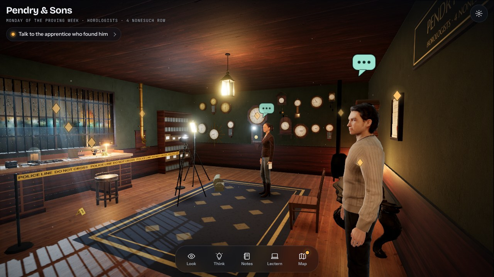
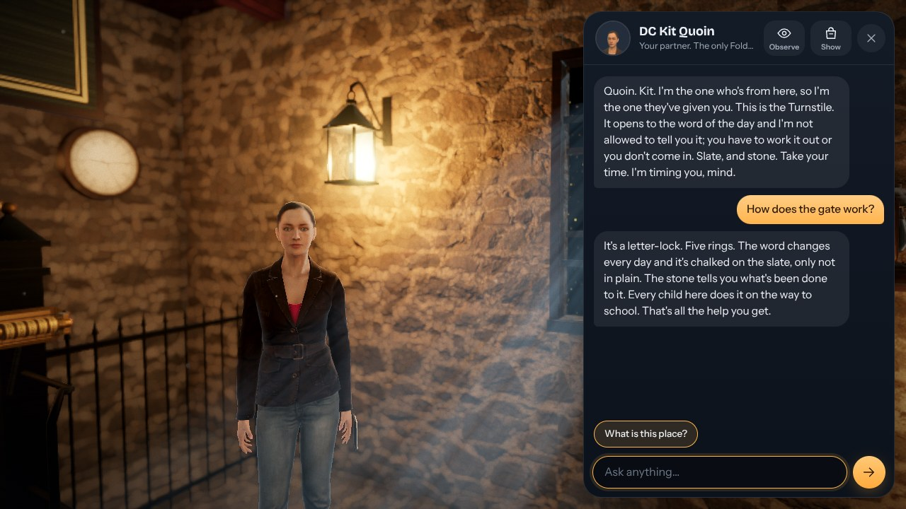
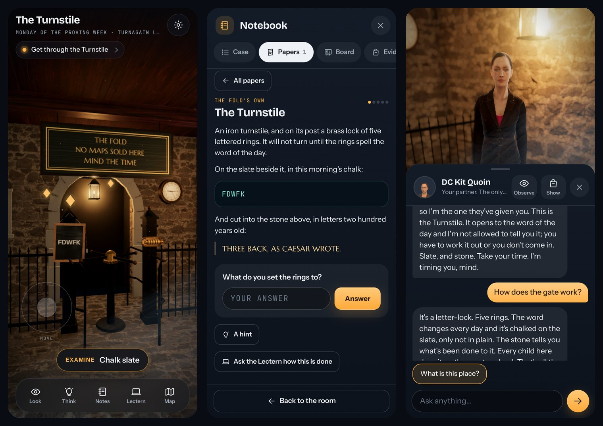

# Greyhaven: The Lamplighter

A 3D detective mystery where every character is played live by Claude.



Someone in a rain-soaked harbour town is drowning old men in their own
armchairs and leaving a lit storm lantern in the window. You are the new
detective. Walk the crime scenes, bag evidence, hear the autopsy, search
police records on your laptop, question people in your own words, catch them
lying, and name the killer before the fourth lantern is lit.

There are three murders, eight locations, nine people to question, four acts
and a twist. It is a few hours long.

## What the AI does

- **Every conversation is improvised.** Type anything. Each character has a
  personality, things they know, things they are hiding and conditions under
  which they crack. They remember what you said and what you showed them.
- **The killer writes to you.** Three unstamped letters turn up on your desk.
  Each is written at the moment you open it, about what you actually did and
  what you missed.
- **The laptop understands questions.** HARBORNET, the police records
  terminal, answers plain language: a name, a number plate, "who signed out
  the pool car on the tenth".
- **The ending is a negotiation.** The last scene is a conversation with the
  killer, with a life depending on it. What you learned decides what you can
  say that lands.
- **The epilogue is yours.** It is written from how your case went.

The story itself is fixed and fair: the same person did it every time, the
clues are always there, and Claude cannot hand out a clue you have not
earned. The rules of the case are code; the voices are Claude.

The game uses Claude Opus (`claude-opus-5-5`).



## Play

```bash
npm install
export ANTHROPIC_API_KEY=sk-ant-...   # your key from console.anthropic.com
npm start
```

Open <http://localhost:3000>.

Without a key the game still runs from start to finish in **scripted mode**:
characters answer the suggested questions from their script and give a stock
reply to anything else. It is a good way to check everything works. It is not
the game.

## On a phone

The phone is the main way to play. Everything is within reach of a thumb, and
nothing needs careful steering.



- **Tap to go.** Tap the floor, a glowing marker or a person and you walk
  there. Drag to look around. The ring at the bottom left steers by thumb if
  you would rather.
- **Look** lists everyone and everything in the room. Tap a name and you walk
  straight to it. With Look and the Map you can play the whole case without
  steering at all.
- **Tools sit in a dock along the bottom**: Look, Think, Notes, Laptop, Map.
  Panels open as sheets from the bottom and close from the bottom.
- **Suggested questions** are one tap. Type or dictate your own whenever you
  like.
- The phone's **Back** button or swipe closes whatever is open instead of
  leaving the game.
- Works upright or on its side. The screen stays awake while you read.
- If movement feels choppy, **Menu, Graphics, Low** turns off the finishing
  effects (bloom, depth of field, frosted glass). The game also steps down by
  itself when it sees the frame rate struggling.

### Install it as an app

Served over HTTPS, the game is an installable web app: it gets its own icon,
opens full screen and starts without a signal.

- **iPhone or iPad:** open it in Safari, tap Share, then *Add to Home Screen*.
- **Android:** open it in Chrome, then *Install app* (or Menu, *Put it on your
  home screen*, in the game).

To get an address a phone can install from, run the server somewhere public,
or host the `dist/app` folder from `npm run build` (below) on any static host.

### Controls

| | Phone or tablet | Keyboard and mouse |
|---|---|---|
| Walk | Tap where you want to go, or steer with the ring | Click where you want to go, or `W A S D` |
| Turn | Drag | Drag, or press `F` for mouse-look |
| Examine or talk | Tap the glowing marker | Click it, or look at it and press `E` |
| Everything in the room | **Look** | `Q` |
| Catch a lie | In a conversation, **Show** puts evidence in front of them | The same |
| Notebook, laptop, map | Dock along the bottom | `N`, `L`, `M` |
| Hint | **Think** | `T` |

### Builds without a server

```bash
npm run build
```

writes three things to `dist/`:

- `greyhaven.html`: the whole game in one file. Open it directly or put it on
  any static host.
- `app/`: the same page as an installable web app (manifest, icons, service
  worker). Host the folder and add it to a home screen; it then opens offline.
- `artifact.html`: the same page packaged as a claude.ai artifact.

The first two have no server behind them, so the characters keep to their
script. As a claude.ai artifact the page asks Claude to play the cast on the
viewer's own account, and no API key is needed.

## Settings

Environment variables for `npm start`:

| Variable | Default | |
|---|---|---|
| `ANTHROPIC_API_KEY` | none | Brings the characters to life |
| `PORT`, `HOST` | `3000`, `0.0.0.0` | Where to listen |
| `GREYHAVEN_MODEL` | `claude-opus-5-5` | Use a different Claude model |
| `GREYHAVEN_AI=off` | | Force scripted mode |
| `GREYHAVEN_DATA` | `./data/saves` | Where saves are written |
| `GREYHAVEN_DEBUG=1` | | Log each model call and its token use |

## How it is built

```
core/                 The game itself. Runs unchanged in Node and in the browser.
  engine.js           Rules: one method per thing the player can do
  brain.js            Turns a game situation into a line of dialogue (Claude, or the script)
  prompts.js          Character sheets and briefs sent to Claude
  view.js             What the player is allowed to see of the state
  cases/lamplighter/  The case: scenes, people, facts, evidence, records, story
server/               Node server: hosts the core, keeps the API key and the saves
public/               The browser client
  src/world/          3D: rooms, props, characters, movement, finishing pass (three.js)
  src/ui/             HUD, conversation, notebook, laptop, map, title, ending
  src/game.js         Ties the world and the UI to the game core
scripts/              Playtest, browser test driver, single-file build
test/                 Tests
```

Everything in the game is made in code. There are no model, texture or sound
files: rooms are built from primitives, textures are painted on canvases and
the rain, foghorn and piano are synthesised. People are made the same way:
their faces are painted, and repainted as they blink, speak and react. (The
only image files are the app icons, drawn by `scripts/make-icons.py`.)

The picture is finished the way a film is: lamps bloom, moonlight comes
through the blinds in shafts, the room falls out of focus behind whoever you
are talking to, and the whole frame is graded. That pass is
`public/src/world/post.js`; it is written for this game and needs nothing
beyond three.js.

When you run the server, the game runs on the server and the browser is a
thin client. The server never sends the browser anything the detective has
not found yet, and it does not serve the case file, so the solution is not
sitting in the page for the curious. In the single-file build the whole game
is in the page.

### Developing

```bash
npm test            # every ending, saves, view leaks, the server, the Claude calls
npm run playtest    # plays the best path through the core and prints the route
npm run dev         # server with reload
```

`node scripts/playtest.mjs --verbose` prints the whole story in order. It is
the fastest way to read the case, and it spoils everything.

`scripts/ui.mjs` drives the real game in headless Chromium for screenshots and
flow checks. It needs Playwright.

`node scripts/prompt-lab.mjs dump all out/` writes the exact requests the game
sends to Claude at a dozen points in the story, as readable text.
`... apply <situation> <answer-file>` feeds an answer back through the game
and prints what it did with it. Useful for tuning a character without
spending a token.

`/dev.html?loc=precinct` is a viewer for single rooms; `?loc=stage` lines up
the cast.

**Spoilers:** `core/cases/lamplighter/` is the solution. Play first.
